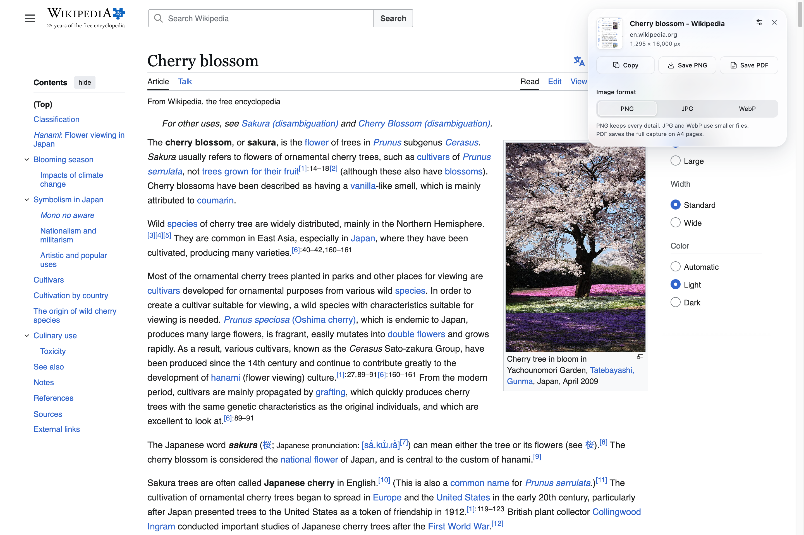

<div align="center">
  
  <h1>PageGrab</h1>
  <p>Capture the full page. Copy it, save an image, or export a PDF.</p>
  <p>A Chrome and Firefox extension with an on-page preview and a glass panel that follows the page's background.</p>
</div>



<p align="center"><sub>The actual capture panel on <a href="https://en.wikipedia.org/wiki/Cherry_blossom">Wikipedia's Cherry blossom article</a>. Export settings are open.</sub></p>

## What you can do

- Capture a whole page, including content below the fold.
- Click the thumbnail to inspect a larger, scrollable preview.
- Copy the capture to your clipboard as PNG.
- Save PNG, JPG, or WebP. PageGrab remembers your image format.
- Export the capture as a PDF split across A4 pages.
- Start a capture from the toolbar, the page's context menu, or `Alt+Shift+P`.

PageGrab captures stable pages in one scroll pass and waits for visible lazy images. If loading changes the page height, it loads the full page and restarts the capture to avoid stitching together different layouts. It also supports a main scrolling container when the document itself does not scroll. The capture restores your original scroll position afterward.

## Install locally

### Chrome

1. Download this project and extract it, or clone it to a local folder.
2. Open `chrome://extensions` in Chrome.
3. Turn on **Developer mode**.
4. Click **Load unpacked** and select the folder containing `manifest.json`.
5. Pin **Full Page Capture** in Chrome's extensions menu. This is PageGrab's name in the manifest.

Chrome loads directly from this folder without a build step or package installation.

### Firefox

Requires Firefox 140 or later and Node.js to prepare the extension folder.

1. Run `node scripts/build.cjs firefox` from the project folder.
2. Open `about:debugging#/runtime/this-firefox` in Firefox.
3. Click **Load Temporary Add-on** and select `dist/firefox/manifest.json`.
4. Click **Full Page Capture** in the extensions menu or pin it to the toolbar.

Firefox removes temporary add-ons when it exits. Permanent installation in standard Firefox requires a signed add-on from Mozilla. The generated folder is ready to package for signing, but this repository does not include a signed release.

Both browsers use the same JavaScript and icons. The build changes only the manifest for Firefox's background scripts, clipboard permission, extension ID, and declaration that PageGrab collects no data. Run `node scripts/build.cjs chrome` to prepare a Chrome folder at `dist/chrome` as well.

## Take a capture

1. Open a web page and click the extension icon, or press `Alt+Shift+P`.
2. Keep the tab active while PageGrab scrolls and captures the page.
3. Use **Copy**, **Save PNG**, or **Save PDF** in the panel. Open **Export settings** to choose JPG or WebP.

Click the thumbnail to expand the preview. Press `Escape` to close settings, collapse the preview, or dismiss the panel.

You can change the shortcut at `chrome://extensions/shortcuts` in Chrome, or under **Manage Extension Shortcuts** in Firefox's add-ons manager.

## Privacy and permissions

PageGrab processes screenshots in your browser. The extension code has no analytics, external API calls, or screenshot uploads. It stores your selected image format in extension-local storage.

| Permission | Why PageGrab needs it |
| --- | --- |
| `activeTab` | Access the tab you invoke the extension on and capture its visible area. |
| `scripting` | Run the capture code and display the panel on that page. |
| `contextMenus` | Add the page context-menu command. |
| `storage` | Remember your preferred image format. |
| `clipboardWrite`, Firefox only | Copy PNG images through Firefox's extension clipboard API, including on HTTP pages. |

The manifest requests no persistent host permissions.

## Capture limits

Browsers block script injection on protected pages, including browser settings and extension stores. Firefox also restricts some Mozilla domains. In Chrome, local `file://` pages require **Allow access to file URLs** in the extension's details.

Pages that block scrolling or keep adding content can stop a capture. Very large captures scale down to fit a maximum canvas dimension of 16,000 pixels and a maximum area of 200 million pixels. The PDF contains page images, so its text is not selectable.

## Development

| File | Purpose |
| --- | --- |
| `manifest.json` | Manifest V3 configuration, permissions, and shortcut. |
| `scripts/build.cjs` | Prepare Chrome or Firefox extension folders with browser-specific manifests. |
| `background.js` | Capture entry points and the shared screenshot rate-limit queue. |
| `content.js` | Scrolling, image stitching, preview, clipboard, and exports. |
| `icons/` | Extension icons and logo assets. |
| `tests/` | Node tests and browser integration checks. |

Run the capture tests with Node.js:

```sh
node --test tests/*.test.cjs
```

The browser checks require Python 3 and Google Chrome. The capture and export checks also need `websocket-client`. The export check needs Pillow and the Poppler commands `pdfinfo` and `pdftoppm`.

```sh
python3 tests/browser_theme.py
python3 tests/browser_capture.py
python3 tests/browser_exports.py
```

The scripts use Chrome's standard macOS installation path. Set `PAGEGRAB_CHROME` to use a different executable.

The capture check reports elapsed time and screenshot count for growing pages, nested scrolling, static pages, and pages that fit one screen. Set `PAGEGRAB_CAPTURE_CASES=static,short` to select cases and `PAGEGRAB_CAPTURE_SOURCE=/absolute/path/content.js` to compare another version. These checks use a screenshot bridge with a 550 ms interval, not the extension's background queue.

The Firefox integration check requires Python's `selenium` and Pillow packages. Selenium Manager must be able to obtain geckodriver on its first run. It installs the real extension in a temporary Firefox profile and checks capture, image/PDF export, and format storage on an HTTP page. Set `PAGEGRAB_TEST_CLIPBOARD=1` to also check copying, which replaces your clipboard with a capture.

```sh
python3 tests/browser_firefox.py
```

Set `PAGEGRAB_FIREFOX` to override the Firefox executable.

After changing extension files, click **Reload** at `chrome://extensions` in Chrome. For Firefox, rebuild with `node scripts/build.cjs firefox` and click **Reload** in `about:debugging`. Reload the page you want to capture afterward.
